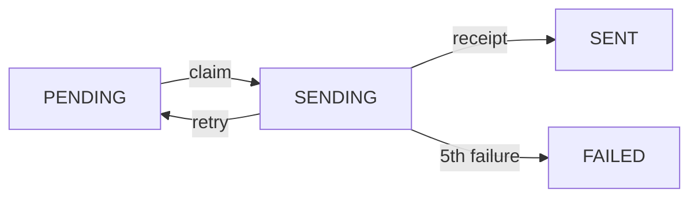

# Decisions

## Architecture

- **Postgres does all the coordination.** I wasn't sure extra infra was allowed. Row claims belong in the database; the rate limiter would be better in Redis.
- `/sent` **is mirrored into a** `receipts` **table.** Retries check it locally instead of calling `/sent` each time. The costs: duplicated data that can drift from the provider (the provider wins), extra database writes, and extra rate-limit tokens.
- **Rate limiting:** a shared bucket at 10 rps (the provider allows 12). Any 429 blocks all workers until the window closes.

## State machine

- **retry,** `attempt_n` **unchanged:** rate limited before anything went out.
- **retry,** `attempt_n + 1`**:** a 500, timeout or dropped connection, a worker error, or a lease older than 10s.

Every write out of SENDING must match `id`, `status` and `attempt_started_at`, so a worker whose lease expired can't overwrite a newer claim. If `attempt_n > 0`, the worker checks `/sent` before sending again.

## Timeout after a possible send

It counts as a failed attempt, so the next try checks `/sent` first. That prevents duplicates only if the provider records a send before replying (this mock does) and each POST finishes inside its lease (2s timeout, 10s lease). A worker that stalls for more than 10s between claiming and POSTing can still double-send.

## What I'd ask the provider for

An idempotency key on `/send`. A lookup by `action_id` still races with a send that is in flight. With the key, a retry can just POST again, so the `receipts` table and the `/sent` sync go away. So do the advisory lock, the tokens spent syncing, and most of the reliance on leases.

## What verify.py can't catch

- A wrong `body`; it only checks the recipient.
- Our records disagreeing with the provider, e.g. FAILED rows that were actually sent.
- Lock collisions, and time workers spend waiting on the row locks and the sync lock.
- Throughput: how long the run took, or how close we came to the 2-minute limit.
- A clean run that was just luck with one seed.

I'd compare our tables against `/sent`, log lock waits and send rate, and run several seeds and kill times.

## At 50,000 actions an hour

- **Rate limits break first.** The provider's 12 rps caps it at 43,200 requests an hour, so it needs a higher limit, a batch endpoint, or several accounts.
- **Database locks come next.** Every request waits on the rate limiter's row lock, and every retry waits on the advisory lock for the `/sent` sync. At this volume, much of the time would go to waiting.
- **Syncing `/sent` gets expensive.** Every page copied into `receipts` costs a rate-limit token, and those tokens come out of the budget for sends.
- **Leases break.** The design assumes a claimed row is always finished within 10s. At high volume, syncing and lock waits take longer, rows outlive their lease, and a second worker can claim and send them.

## Not built

- Scheduling (`scheduled_at`).
- Lease renewal, and a lease check right before the POST.
- A final `/sent` check before marking a row FAILED.
- Graceful shutdown on SIGTERM.
- A central logger for running several workers; each worker uses `print` for now.
- Metrics and tests.

## [verify.py](http://verify.py)

3 workers, `kill -9` at 60s: 500/500 present, 0 duplicates, no warnings.